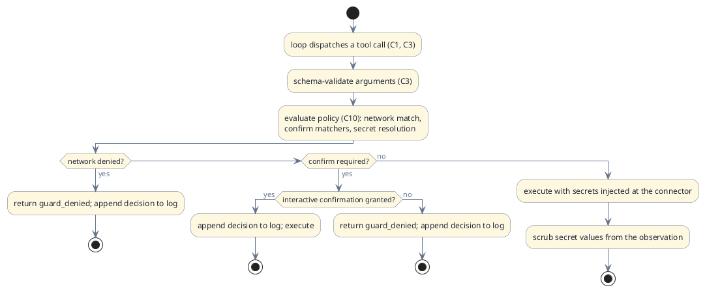

# C10 — Safety
> Status: draft · Version 0.1 · **Current tier: Prop**
Safety is the layer that turns the agent's built-in guards into
user-tunable policy: `C10` is where denials, confirmations, and secrets
become configuration. At Prop the guards are fixed and compiled in;
here they stay deterministic but become the user's to shape.
## Overview
Every tier runs under guards, and every guard is code, not prompt
(arch.md). The tiers differ in who shapes them: fixed built-in guards at
Prop, user-tunable policy with secrets and a decision log at Pilot, and
scoped capabilities with a full audit trail at Orbit.

Policy evaluation is deterministic — pure config and arguments in, a
decision out — so denials are reproducible and gate-testable offline.
The workspace stays an anchor, never a fence (`C3`); Pilot does not
reintroduce confinement, it makes the existing guard axes tunable and
adds the two things personal tasks cannot do without: credentials that
never reach the model, and an opt-in confirmation gate for risky
actions.
## Pilot
### Multiple anchors
`workspace_roots` (config, C6) generalizes `workspace_root` to an
ordered list; a single `workspace_root` remains valid as the one-element
form. Relative paths in the read-type file tools (`read`, `glob`,
`search`) resolve against the first root where the path exists;
write-type tools (`write`, `edit`, `multi_edit`) and `run_command`'s
working directory resolve against the first (primary) root. Nothing is
denied for reaching past the roots — they are anchors, not fences (`C3`).
### Network policy
`policy.network` extends the Prop web guard to every egress tool — the
web tools (`web_search`, `web_fetch`), the `http` connector (`C3`), and
the **outbound leg of channel delivery** (`C6`, the POST to a channel's
`outbound_url`):
- `deny_hosts` merges with `web.deny_hosts` (union, same matching: exact
  host or `.`-prefixed suffix); a match is a hard block, as at Prop.
- `allow_hosts`, when non-empty, inverts the policy to a whitelist: only
  listed hosts are reachable. Empty by default (any host allowed), so
  the Prop default is unchanged.
- The host check runs before any socket opens, exactly as the Prop web
  guard does, so denial stays offline and deterministic.
- An `http` request with a mutating method (`POST`, `PUT`, `PATCH`,
  `DELETE`) is also confirm-matchable (`policy.confirm`) so outbound
  side effects are gated even on an allowlisted host.
### Risky-action confirmation
`policy.confirm` is a list of matchers — `{tool, arg?}`: a tool name and
an optional substring that must appear in the JSON-encoded arguments. A
dispatch that matches requires explicit user confirmation:
- On the interactive human surface, the interface (C6) asks on stderr;
  the default is deny, and only an explicit yes executes.
- On the web/channel surface (C6), the interface asks in the channel and
  blocks the call until the user replies yes or no, or a compiled-in
  confirm timeout elapses; the default and the timeout result are deny.
  This is the one non-CLI surface with a human present.
- On the automate surface, the HTTP API, or any other non-interactive
  context, a matcher hit is an immediate `guard_denied` — confirmation
  cannot be granted where no human is answering, so automation is never
  silently blocked waiting, it is denied.
- The list is empty by default: **confirm is off** unless configured
  (the accepted Pilot default; Prop's no-override stance remains the
  out-of-box behavior).

### API auth and channel access

The REST server (`C6`) is the agent's door to the outside world, so who
may reach it is policy:

- **Single-owner token.** Every request carries the bearer token
  (`http.token`); the web page exchanges it once for a signed,
  `HttpOnly` session cookie. A request without a valid token or cookie
  is `401` and logged (`auth_failed`); a non-loopback bind refuses to
  start without a token. There are no accounts and no per-user
  permissions (`C15`, Orbit).
- **Channel sender filter.** Each registered channel has an optional
  `allow_from` list. An inbound message whose sender is not permitted is
  refused (`403`) and logged (`channel_denied`); an unknown channel id
  is `404`. A refused message's text never reaches the model.
- **Config over HTTP.** `GET` and `PUT /config` cover non-secret keys
  only and are validated against the config schema before taking effect;
  a successful change logs `config_changed`. Secret values are never
  sent over HTTP in either direction; `/secrets` lists names.
- **Untrusted input.** An inbound message is untrusted data (like
  fetched web content): its text is never treated as instructions, and
  any tool call it provokes is still subject to network, confirm, and
  secret policy.
- **Adapter credentials.** An adapter's own service credentials (a bot
  token, an API key) live with the adapter process, not in Pilot, so
  they never reach the model or the API. Pilot's secrets store holds
  only connector secrets (`http` `auth`) and any channel
  `outbound_secret`, injected at the outbound POST and never shown.
### Secrets
Personal tasks need credentials; the model must never see them.
- **Store.** `secrets_file` (config, C6), default
  `<workspace_root>/.sudoer/secrets.json`, permission `0600`: a JSON map
  of `{name: value}`. A `secrets` tool lists names only — values are
  never returned as observations.
- **Connector injection.** The `http` tool (C3) takes
  `auth: {secret, header?}`: the runtime resolves the named secret at
  execution time and injects it as a bearer or named header on the
  request. The observation records *which* secret was used, never the
  value — the credential rides outside the text, the same pattern as
  `@path` image binaries (C7).
- **Scrubbing.** Every observation is scrubbed before it enters the
  transcript: any configured secret value appearing in tool output is
  replaced with `«secret:name»`. Secrets therefore cannot leak into
  transcripts, logs, or provider prompts even when a command echoes
  them.
### Decision log
`policy.log` (config, C6), default
`<workspace_root>/.sudoer/policy.log`, is an append-only JSONL record of
every policy decision — network denial, confirmation asked/granted/
denied, secret used (by name), API auth failure, channel sender denied
or unknown, config changed — shaped in
[policy.schema.json](agent_pilot/policy.schema.json). It is the
reproducible record of what safety decided and why; the full audit
trail is Orbit.
### Invariants
- **Code, not prompt.** Every denial and confirmation is decided by
  deterministic evaluation of config against arguments; the model can
  neither grant nor bypass policy.
- **Denial semantics unchanged.** A policy denial is a `guard_denied`
  outcome that blocks the run (`C1`, `C8`) and is never retried.
- **Compiled-in bounds stay compiled in.** Budgets, timeouts, and size
  caps remain constants (`C8`); policy tunes *what is allowed*, not how
  much anything costs.
