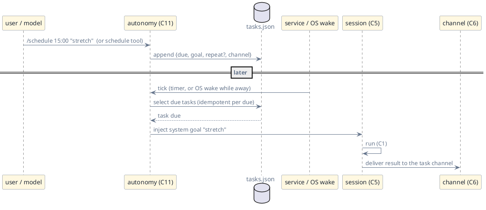

# C11 — Autonomy

> Status: draft · Version 0.2 · **Current tier: Prop**

Autonomy is the agent acting on its own behalf at the right moment:
`C11` is the machinery that lets work start without a user typing a
goal. At Pilot that means a **resident service** that holds the clock
and a store of **user-set scheduled tasks** — one-shot reminders and
recurring routines — plus **delegated background work** that continues
after the user walks away. The agent still never invents a goal; it
executes on a schedule, it does not choose its own.

## Overview

The loop (C1) is reactive: a goal arrives, a run answers. Autonomy is
the layer that injects goals from the inside. Every tier has one: at
Prop none — the user is the only goal source; at Pilot user-set
scheduled tasks fired by a resident service (woken by the OS when it is
not running); at Orbit self-directed long-horizon work.

Pilot's autonomy is designed so that "a reminder at 15:00" actually
fires at 15:00, whether or not an interactive session is open, and
whether or not the process happens to be awake. The trick is that the
scheduler is not a boundary check: it is a **timer with an OS wake**.

A task is a user-set goal with a due time. The user sets it through the
interface (`/schedule`, `/remind`) or asks the agent to set it (the
`schedule` tool); either way it is user-directed — the agent never
schedules work for the user unprompted at Pilot.

## Pilot

### The resident service

`sudoer-pilot serve` is the resident service. It hosts, in one process:
the REST server (`C6`), the channel registry (`C6`), the scheduler, and
the background-task runner. It is the only long-lived Pilot process, and
it does exactly one autonomous thing: run tasks the user enrolled.

The service may also run in a **wake-only** mode: the OS scheduler
launches `sudoer-pilot tick` at the next due time, which fires due
tasks, delivers their results, and exits. Wake installation is an
explicit user action:

- `sudoer-pilot install` registers an OS wake for the next due time and
  re-arms as the store changes:
  - Linux — a `systemd --user` service + timer (fallback: a `crontab`
    entry);
  - macOS — a `launchd` LaunchAgent with `StartCalendarInterval`;
  - Windows — a Task Scheduler task.
- `sudoer-pilot uninstall` removes it; `sudoer-pilot status` reports
  whether the service runs and when the next fire is.
- If no wake is installed, tasks fire only while the service (or a CLI
  session that loads the scheduler) runs; `status` says so.

The OS scheduler is an injected adapter (`Scheduler`): the real
implementations above, and a deterministic fake under the gate.

### Task store

A persisted list at `tasks_file` under the `.sudoer` directory (config,
`C6`), frozen in [autonomy.schema.json](agent_pilot/autonomy.schema.json):
records of `{id, when, goal, repeat?, channel, status, created, updated,
next_due?, last_run?}` with status `pending`, `fired`, `done`, or
`cancelled`. A legacy `reminders.json` (C11 v0.1) is migrated on read.

- **`when`.** An ISO 8601 timestamp or a relative `+<n><m|h|d>`
  (resolved against the current time when set). It sets the first
  `next_due`.
- **`repeat`.** Absent for a one-shot; otherwise a recurrence that
  advances `next_due` after each fire:
  `+<n><m|h|d>` (fixed interval), `daily@HH:MM`, or
  `weekly@<mon..sun>@HH:MM`.
- **`channel`.** Where the result goes: `notify` (desktop), `origin`
  (the channel the task was created from), or a registered channel id
  (`C6`). Default: the origin channel.
- **`origin`.** The transport and sender that created the task, so a
  recurring routine reports back where it came from.

### Setting and listing

- **Commands.** `/schedule <when> <goal>` (and its one-shot sugar
  `/remind <when> <goal>`) on any surface; `/tasks` lists pending
  tasks with ids and next due times; `/tasks cancel <id>` cancels one;
  `/tasks run <id>` fires one now.
- **Tool.** `schedule {when, goal, repeat?, channel?}` — a built-in
  catalog tool (`C3`) so "remind me to X" and "every morning, do Y"
  goals are executed rather than declined; the model sets the task and
  finishes by confirming it.

### Firing

The scheduler computes the earliest `next_due` in the store and arms
the next wake; on a tick it fires every task whose `next_due <= now`.

- **Check points.** A tick happens when the service's timer elapses, on
  service start, and on an OS wake (`tick`). It is a clock comparison
  against an injected clock — cheap, and deterministic under the gate.
  A check at a run boundary also catches a task that came due mid-run.
- **No interruption.** A task due mid-run does not cut the run short:
  it is queued and becomes the next goal in its session when the current
  run finishes.
- **Injection.** A fired task enters the transcript as a
  **system-origin goal** — a `userEntry` marked `origin: system`
  (schema addition beside Prop's, `schemas.md`) — and runs like any
  goal: the loop may answer in text or act, which for a reminder usually
  means `notify` or `send` (`C3`). Status moves
  `pending → fired → done` when its run completes; a recurring task
  goes `fired → pending` with an advanced `next_due`.
- **Idempotency.** Firing is idempotent per `(task id, due instant)`:
  the store records the fire before the run starts, so a crash or a
  redundant OS wake never double-fires. An interrupted run resumes at
  the same fire, not a new one.
- **Catch-up.** A task that came due while the machine was off is, by
  policy (`autonomy.catch_up`): `fire` — run it late, labeled `[late]`
  (the default for recurring tasks), or `report` — list it to the user
  and leave it pending (the default for one-shot reminders, so acting
  unprompted on a stale reminder stays the user's call).

### Background work

Delegated background work is the same machinery for a single fire: the
user asks the agent to do something long and report when done
("run the tests and tell me"), and the agent enrols it via `schedule`
(or runs it in the service while the CLI exits). The service executes
the run even after the originating process has exited, then delivers the
answer to the task's channel.

- **Durability.** A background run is a task record plus a session; if
  the service restarts, an unfinished background run is resumed, not
  lost (`C8`).
- **Bounds.** At most a compiled-in number of background runs execute
  concurrently (`C8`); excess fires queue. A background run uses the
  same guards as any run (`C1`, `C8`) — budget, timeouts, best-effort.

### Invariants

- **System-fired, model-reacted.** The scheduler fires on the clock;
  only the loop decides what the task's run does (arch.md, capability
  boundary — the model never wakes unprompted).
- **Time is injected.** All due-time comparisons, arming, and wake
  decisions use the injectable clock (`C8`), so firing is reproducible
  offline in the gate.
- **User-set only.** Every task originates from a user action (command
  or tool call in a user goal); the service never fabricates a goal.
  Self-directed scheduling is Orbit.
- **No hidden daemon.** The only long-lived process is the service the
  user starts and can stop; `uninstall` removes every OS hook.
