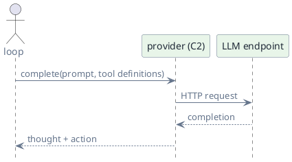
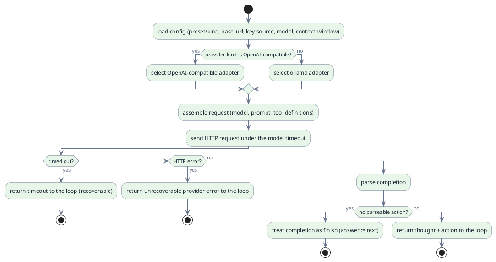

# C2 — Providers

> Status: draft · Version 0.8 · **Current tier: Prop**

The provider is the model behind the loop: `C2` is the single boundary
through which the agent reaches an LLM. The loop decides; the provider
turns a prompt into a thought and an action.

## Overview

A provider adapts the agent's request shape to one LLM API. Every tier
reaches models through this boundary, so the loop never knows which backend
is in use. The tiers differ in how many providers exist and how they are
selected: one active provider chosen from a built-in catalog at Prop, which
may set the per-model parameters coding needs (sampling, context); an ordered
chain with fallback and roles at Pilot; and a registry with OAuth at Orbit.



The provider is stateless with respect to the run: it receives a fully
assembled prompt (see `context`, C4) and returns the model's next output.
The loop (C1) calls it once per iteration; what to send and what to do with
the reply belongs to the loop, not here.

## Prop

Prop runs exactly one provider at a time, selected from two
user-configurable adapters — an OpenAI-compatible HTTP endpoint or ollama —
through a built-in catalog of presets. A preset names the base URL, the
conventional key environment variable, and a starter model list; the active
provider never changes *during* a run (it may switch between goals, below).
The catalog selects which single provider serves the session; there is still
no failover. The boundary itself is an interface, and the build gate injects
a third, non-configurable scripted adapter behind it — never reachable
through config (`agent_prop/gate.md`). A timeout is returned to the loop as a
recoverable observation; an unrecoverable provider error is returned as such
and blocks the run (`reliability`, C8).



- **One active provider, two adapters.** The configured preset or kind
  selects one of the two user-configurable adapters; a run never switches
  backend. The scripted gate adapter implements the same boundary but is
  injected by the harness, not configuration.
- **Stateless.** The provider holds no conversation state — the prompt is
  passed in full on every call.
- **Called once per iteration.** The loop (C1) invokes the provider for
  exactly one step's decision; the provider never loops on its own.
- **Multiple tool calls.** One completion may request several tool calls; the
  adapter normalizes them into a single action carrying a tool-call batch
  (`message` `action`), preserving the model's order. Independent read-only
  calls may then run in parallel (C1). Streaming merges each call's deltas by
  its index, so interleaved calls reassemble into the same batch.
- **Model and window.** The configured model fixes the context window that
  `context` (C4) fits the prompt against. The window comes from the catalog
  entry, a config override, or the conservative default; `/model` takes the
  catalog window for a known id and keeps the current window for an unknown
  one.
- **Coding-scoped per-model parameters.** The context window and, where the
  adapter supports them, sampling parameters are part of Prop's model config.
  The catalog may offer many models, but Prop still selects exactly one per
  run; failover, roles, and OAuth are not part of the catalog.
- **No fallback.** There is one endpoint; a failure is returned rather than
  retried against another backend. A timeout is retried by the loop
  re-iterating, not by switching providers.
- **Malformed output.** A completion with no parseable action is treated as
  a `finish`, using the completion text as the answer (C1).
- **Streaming.** When the caller supplies a delta callback, the adapter
  requests a streamed completion (OpenAI `stream: true` over SSE; ollama
  `stream: true` over NDJSON), invokes it with each new chunk of *visible*
  text as it arrives, and assembles the full completion at the end. A second
  callback carries the *reasoning* stream (see below); supplying either one
  selects the streamed path. Without a callback the adapter makes the one-shot
  request. Both paths normalize to the same completion.
- **Streaming timeout.** A streamed call is guarded by an inactivity timeout
  reset on each chunk (rather than one total deadline), so a long generation
  is not cut off while it is producing output; a stalled stream fails as a
  recoverable timeout (C1, C8).
- **Reasoning convention.** A model may wrap private reasoning in a
  `<think> … </think>` block:

  ````
  <think>
  the file may have drifted from the header
  </think>
  Here is the summary.
  ````

  Like the plan block, the adapter strips it from the visible text and
  normalizes it into a separate `reasoning` string; it is never part of the
  answer. On the streamed path the reasoning is emitted to the reasoning
  callback as it arrives and withheld from the visible callback; a
  partially-arrived tag is buffered until it resolves. A missing block, or an
  unclosed one, is handled without dropping visible text. The human interface
  (C6) renders reasoning dim and italic; the plan block is then parsed from
  the remaining visible text, so the two conventions compose.
- **Plan convention.** A plan update is carried in the completion text as a
  fenced block labelled `plan` whose body is one Markdown checkbox per item
  (`- [ ]` pending, `- [x]` done):

  ````
  ```plan
  - [ ] read the file
  - [x] answer
  ```
  ````

  The adapter strips the block from the visible text and normalizes it into
  `planItem`s (C1); a non-`plan` fenced block is left untouched, and a
  missing or itemless block means the plan is unchanged. The system prompt
  teaches the model this convention (`context`, C4).
- **Text completions.** The reply is text plus optional tool calls; no
  multi-modal output (`modality`, C7). The visible text is treated as markdown
  (the interface renders it on the human surface, C6); the provider passes it
  through unchanged.
- **Tool-call binding.** A tool call keeps the provider's id; the loop (C1)
  binds the matching observation to it. Replaying a transcript sends an
  assistant `tool_calls` message paired with its `role: tool` results (one per
  call), and never sends a tool result whose tool call is absent — harness
  observations such as a provider timeout are replayed as user messages
  instead. A tool
  call with an empty name is malformed and is replayed as plain assistant
  text (with its observation as a user message), since an empty
  `function.name` is rejected by the endpoint. Streaming a tool call merges
  the `id` and `name` from the first delta that carries them and concatenates
  argument fragments: a later delta that repeats them as empty strings (as
  MiniMax does) must not erase the earlier values.
- **Configuration.** Reads `provider.preset`, `kind`, `base_url`, `model`,
  `context_window`, `api_key`, `api_key_env`, and `sampling` from config,
  loaded by the interface (C6); the key may also come from the auth store.
  The configured provider is fixed during a run and may change at a goal
  boundary (`/provider`, `/model`).
- **Model timeout.** The HTTP call is wrapped by the model-call timeout
  defined in `reliability` (C8).

### Catalog and credentials

Prop's CLI carries a small provider catalog, so hooking up a model does not
mean hand-writing an endpoint and guessing a context window. It is a
convenience over the two adapters, not a third adapter layer: every preset
resolves to an OpenAI-compatible or ollama endpoint.

- **Presets.** A preset (`provider.preset`) names a base URL, the
  conventional key environment variables, and a starter model list. The
  catalog carries the curated core (`openai`, `anthropic`, `google`,
  `openrouter`, `groq`, `deepseek`, `mistral`, `xai`, `zhipuai`,
  `moonshotai`, `minimax`, `minimax-cn`, `cohere`, `fireworks-ai`, `deepinfra`,
  `cerebras`, `ollama-cloud`, `ollama`, `lmstudio`, `custom`) plus the full
  OpenAI-compatible provider set from models.dev/OpenCode (Nvidia, OpenCode
  Zen, Z.AI, Alibaba, regional and coding-plan variants, gateways, and the
  long tail). `--list-providers` is authoritative; it covers 211 of
  models.dev's 232 providers. The remaining 21 need a native SDK (Bedrock,
  Vertex, Azure, native Anthropic/Google, …) or a per-account URL placeholder,
  so they are not listed; use `custom` or an OpenAI-compatible gateway for
  those. The generated part is
  checked in and refreshed from `models.dev/api.json`; providers whose base
  URL needs a per-account `${…}` placeholder are left to `custom`. `custom`
  takes a user-supplied OpenAI-compatible base URL. MiniMax keys are
  region-specific: `minimax` is the international `api.minimax.io` endpoint
  and `minimax-cn` is the China `api.minimax.cn` endpoint; a 401 from the
  wrong region carries a hint naming the other preset.
- **Selection.** `--provider <id>`, `--model <id>`, `--base-url`,
  `--context-window`, `--api-key`, and `--api-key-env` override the config
  for one process; `--list-providers` and `--list-models` inspect the
  catalog. Inside a session, `/provider [id]` and `/model [id]` list and
  switch at a goal boundary (C6); the agent is rebuilt, and a run always
  starts and finishes on one provider.
- **Setup.** `sudoer-prop --setup` (alias `--login`) is the interactive
  path: pick a preset, enter the key with a masked prompt, discover the
  endpoint's models, pick one, and write the config. It uses `dart_tui` for
  the terminal UI rather than a bespoke prompt: full-screen prompts (the
  alternate screen) and pasteable key/text fields.
- **Credential store.** Keys entered by setup live in
  `~/.config/sudoer/auth.json` (XDG; `%APPDATA%` on Windows;
  `SUDOER_AUTH_FILE` overrides), owner-only (0600), never in the project
  config and never echoed. A config
  can instead reference `provider.api_key_env` or a literal `api_key`.
  Precedence is `api_key` → auth store → `api_key_env` → the preset's
  well-known env var.
- **Key validation.** A key must be printable ASCII with no whitespace
  (surrounding whitespace is trimmed). Setup and `--save-key` reject anything
  else before storing it; a stale value already in the store or environment
  is reported as `invalid` by `--list-providers` and by the startup hint, and
  is never placed in an HTTP header. The message names the problem, never the
  value.
- **Discovery is best-effort.** `--list-models` and setup call the
  endpoint's `GET /models` (OpenAI-compatible) or `GET /api/tags` (ollama)
  and merge the live ids over the static catalog; known ids keep their
  curated name and context window, unknown ids get a conservative 128k
  fallback. Offline, the static catalog is used.
- **No fallback.** The catalog selects one provider; a failure is returned,
  never retried against another backend. Failover remains Pilot's job.
- **Secrets stay out of the transcript.** The CLI never prints a key, and a
  key entered at setup is not written into the config or the session (C5).

## Pilot

Pilot keeps Prop's provider catalog and replaces the single active provider
with an ordered **chain** and a small role catalog, for availability — not
for new coding power (arch.md: the mechanism exists to stay reachable, which
personal tasks need and coding does not). The catalog still names endpoints
and models; the chain adds failover order and roles.

- **Chain.** `providers` (config) lists entries in failover order; the
  Prop `provider` key remains valid as the one-element form. Index 0 is
  primary. Every entry is a full Prop provider block; the configured kind
  of each selects its adapter, so the chain may mix adapters.
- **Roles.** `roles` maps names to `{provider index, model?}`. `main`
  (default: index 0) serves the loop; `fast`, when set, is used for
  tools-withheld calls — the compaction brief (`C4`) — reusing a smaller
  model without changing loop behavior. `/model` (C6) switches `main`
  at a goal boundary; a run always starts and finishes on one provider.
- **Embedding role.** `embed`, when set, names the provider+model used
  for memory embeddings (`C9`); it may point outside the failover chain
  (an embeddings-only endpoint). When it is unset, memory uses the
  configured `memory.embedder` directly (`C9`). The embedder is a
  separate adapter path from the chat completion boundary: it shares
  no loop state and never consumes the chain's failover.
- **Retry, then failover.** A call first retries in place with bounded,
  compiled-in backoff (`C8`). If it still fails — timeout or
  unrecoverable — and the chain has a next entry, the *same assembled
  prompt* is sent to it: the provider is stateless, so failover is
  exact. Only when the chain is exhausted does the failure surface, with
  Prop's semantics (timeout recoverable, unrecoverable blocks).
- **Streamed failover.** A streamed call fails over only while no
  visible chunk has arrived; once text has been delivered, an
  inactivity timeout surfaces as a recoverable observation rather than
  re-streaming a partial answer from another backend.
- **Failover is observable.** A failover is reported through the
  structured log (`C8`) and the verbose diagnostics, never silently.
- **Scripted chain.** The gate injects a chain of scripted providers the
  same way Prop injects one — harness-injected, never config-reachable
  (`agent_pilot/gate.md`).
