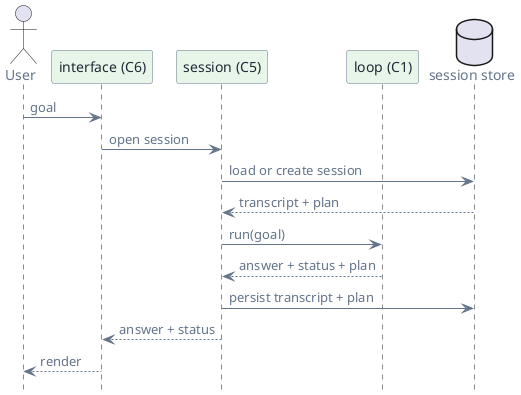
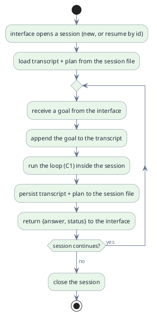

# C5 — Sessions

> Status: draft · Version 0.6 · **Current tier: Prop**

A session is the scope that surrounds a run: `C5` is the container the loop
executes inside and the rules for what state, if any, persists around it.
The loop is one execution; the session is what may be remembered after it.

## Overview

A run (C1) begins with a goal and ends with an answer. A session is the
scope that can span runs, holding the transcript and any associated state.
Every tier runs the loop inside a session; the tiers differ in what the
session retains: a persistent local transcript at Prop, a searchable
session store at Pilot, and multi-device sync with lineage at Orbit.

The store is a local session file at Prop and a searchable store at
Pilot. The session is the layer between the interface (C6) and the loop
(C1): the interface opens or resumes it, the loop runs inside it, and it
hands the run's `{answer, status}` back to the interface.

## Prop

Prop keeps one continuous session. The interface (C6) opens a session at
startup — new, or resumed from disk by id — and every goal is a run inside
that same session. The transcript and the plan survive the run: they are
written to a local session file, so the session can be resumed after the
process exits. Consecutive goals therefore share history, which is what lets
Prop work on a task across many runs and build itself.

- **Continuous.** One session spans many goals and runs; the process does not
  exit after one answer but returns to the prompt (C6).
- **Persistent.** The transcript and plan are written to a local session file
  after each run, so nothing is lost if the process ends.
- **Resumable.** A session has an id; `C6` resumes a saved session and
  continues from its transcript and plan, re-adopting the session's recorded
  `workspace_root`.
- **Readable id.** A new session's id starts as the local-time stamp
  `YYMMDD-HHMMSS` (e.g. `261020-142530`): sortable, recognisable at a glance,
  and safe as a filename. After the first run, the model summarizes the
  session's first goal into at most five keywords and the id (and file name)
  gains them: `YYMMDD-HHMMSS_<keywords>` (e.g.
  `261020-142530_fix-login-loop.jsonl`). Same-second collisions are resolved
  on disk with a numeric suffix; a caller may pin an explicit id (`--session`,
  `C6`), which is used verbatim and never renamed.
- **Workspace.** The session records its active `workspace_root`; changing
  the workspace during a session (`C6`) updates and persists it.
- **Workspace baseline.** When a session opens, `C3` captures a baseline of
  the workspace (file identities and contents), lazily — nothing is copied up
  front, and `diff` falls back to the underlying VCS where one is present; the
  session records its handle so `diff` and `restore` (`C3`) survive across
  runs. It is refreshed only when the workspace root changes (`C6`), is never
  shown to the model, and is not the transcript — it backs review and undo.
- **Session ≠ memory.** Persistence here is continuity of a conversation and
  its plan. Durable, curated, cross-session *knowledge* is `memory` (C9), a
  Pilot component, and is not built here.
- **Local only.** The session file lives on disk beside the agent; there is
  no session store, search, or sync (those arrive at Pilot).
- **Retained on failure.** A blocked or cancelled run still persists its
  partial transcript, so the next goal can recover from it.

### Session file

One JSONL file per session, written under the app directory
(`~/.config/sudoer/sessions` at Prop) or a configured session directory; the
first line is a header object holding at least `id`, `stamp`, `created_at`,
`updated_at`, `workspace_root`, and `plan`, plus the workspace `baseline`
handle backing `diff`/`restore` (`C3`) and the naming `keywords`; every
following line is one transcript entry. The exact shape is frozen in
[session.schema.json](agent_prop/session.schema.json) with the rest of
Prop's contracts (`schemas.md`).

## Pilot

Pilot turns the session directory into a **store**: an index over saved
sessions with search, and a registry allowing several sessions to be open
at once. Session files themselves keep the Prop shape — the index is
derived and rebuildable, never a second source of truth.

- **Index.** `index.json` in the session directory records, per session:
  `id`, `title` (first goal, first line), `workspace_root`, `channel?`,
  `created`, `updated`, `runs`, and `last_status`. Updated atomically
  (temp + rename) whenever a session file is written.
- **Channel-keyed sessions.** A session may be bound to a channel — a
  registered REST client (the web page or a messenger adapter, `C6`).
  An inbound message resolves its channel's session (creating one on
  first contact), so each messenger or thread keeps continuous history;
  a scheduled task (`C11`) runs in its channel's session. The mapping
  lives in the derived index, so it is rebuildable and never a second
  source of truth.
- **Search.** `/sessions [query]` (`C6`) and the HTTP API filter the
  index by id, title substring, or date, then optionally grep matching
  session files' transcripts — deterministic text search, capped
  results, like `search` (`C3`). Conversations are searched here;
  knowledge lives in memory (`C9`).
- **Concurrent sessions.** One process may hold several open sessions
  (the HTTP API requires it); runs within one session are serialized —
  a second run on a busy session is rejected, not queued (`C6`) — while
  runs across sessions proceed in parallel (`C8`). Every store write is
  atomic.
