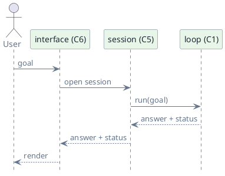

# C6 — Interface

> Status: draft · Version 1.9 · **Current tier: Prop**

The interface is how a human reaches the agent: `C6` is the surface that
takes a goal in and puts an answer out. The loop is the engine; the
interface is the dashboard.

## Overview

Every tier exposes the agent through some surface, and every surface funnels
into the same session (C5) and loop (C1) with a goal and an answer. The
tiers differ in the surfaces offered: a human terminal UI and a line CLI for
automation at Prop; a **web page** for non-technical users and a
**REST server** that everything else (messenger adapters, scripts, the
scheduler) plugs into, at Pilot; and a multi-user gateway with desktop
clients at Orbit.



The interface does not reason. It parses input, normalizes it (`modality`,
C7), opens a session, invokes the loop, and renders the result — nothing
about *how* the goal is solved lives here.

## Prop

Prop has two presentations of the same resident session. On a terminal the
**human** surface is a full-screen TUI: a fixed header, a scrollable
transcript, a multi-line editor, and a status footer. Its layout follows Pi's
interactive mode — the transcript scrolls while the editor and status area
stay put — and it uses the alternate screen so the shell's scrollback is
restored on exit. `--inline` keeps the older styled scrollback surface (a
`› ` prompt with a line editor) for terminals where a takeover is unwanted.
Under `--automate`, or when stdin/stdout is not a terminal (a pipe, a script,
the gate), the **automate** surface is plain, one-shot, and pipe-friendly.
Either way, a line that begins with `/` is a **command** handled locally; any
other line is a **goal**, normalized by `C7` and run inside the current
session. There is no server or daemon, but there is a resident session, and
it outlives a single goal.

```plantuml
@startuml
skinparam backgroundColor transparent
skinparam defaultFontColor #64748B
skinparam activityBackgroundColor #E8F5E9
skinparam activityBorderColor #64748B
skinparam activityFontColor #1F2937
skinparam arrowColor #64748B
start
:parse startup arguments; load config; open session (C5);
if (--automate or stdin/stdout not a terminal?) then (yes)
  :automate surface (plain, one-shot);
else (no)
  :human surface (full-screen TUI, or --inline);
endif
repeat
  :read a goal or command from the editor;
  if (line begins with "/"?) then (yes)
    :handle command locally;
    if (command is exit?) then (yes)
      :close session; stop
    endif
  else (no)
    :normalize goal (C7); append to session;
    :run the loop (C1) inside the session;
    :stream the reply into the transcript; show a thinking footer;
    :render answer and status;
  endif
repeat while (still running?) is (yes)
@enduml
```

### Commands

| Command | Effect |
| --- | --- |
| `/help` | list commands (a popup on the TUI) |
| `/exit` | persist and close the session, then exit (alias: `/quit`) |
| `/new` | start a new session (new id) |
| `/sessions` | list saved sessions (a pick-to-resume popup on the TUI) |
| `/resume <id>` | switch to a saved session (a picker on the TUI) |
| `/plan` | print the current plan (C1) (a popup on the TUI) |
| `/status` | print the current run status and budget use (C1, C8) |
| `/provider [id]` | list the provider presets, or switch the active provider (C2) (a filterable picker on the TUI) |
| `/model [id]` | list the current provider's models, or switch model (C2) (a filterable picker on the TUI) |
| `/context [mode]` | show or switch the context strategy, `harness` or `clm` (C4) |
| `/diff` | show the workspace's changes against the session baseline (C3) |
| `/cancel` | cancel the in-flight run (C1, C8); automate surface only |
| `/compact` | fold earlier context into a brief now (C4) |
| `/workspace [path]` | print or change the workspace root (C3) |
| `/verbose on\|off` | emit per-step diagnostics (transcript in the TUI; stderr otherwise; off by default) |

Behavior change on the fly is limited to session and interface concerns —
the active session, the plan, the workspace root, verbosity, the context
strategy, and the active provider/model. `/provider` and `/model` rebuild the
agent and take effect at the next goal boundary; a run always starts and
finishes on one provider (`C2`). Safety policy remains compiled in and is not
switchable (`C10`); a full provider chain with failover and roles arrives
with Pilot (`C2`).

- **Human surface (full-screen TUI).** The default on a terminal. The
  alternate screen holds a compact header (build, active provider/model,
  workspace, session, transcript size, and the plan as a live checklist once
  one exists), a scrollable transcript, a bordered
  multi-line editor, and a footer. The transcript streams the reply as it is
  generated; tool calls, results, reasoning, commands, and diagnostics appear
  in it with the same channel styling as `--inline`. The footer carries the
  thinking spinner and step/context detail while a run is in flight, and the
  latest status after it: result, response number, context use against the
  window as `used/window (percent)` with token counts in K/M units, plan
  progress, step/budget, and workspace. The header carries the plan itself as
  an ongoing progress indicator: a bordered panel whose rows checklist the
  steps — a green check per done step, a marked active step (the first
  pending one), and a dim circle per queued step — folded to a bounded number
  of rows (`… +N more`) so it never crowds out the transcript. The plan is
  live twice over: the streaming adapter reports each plan item as the model
  writes the block, and each response's authoritative plan lands with the
  response — the checklist never waits for the run to finish. Queued
  follow-up messages (Enter while a run
  is in flight) draw as their own bordered `queued` panel between the
  transcript and the editor, folded with `+N more` when long. The editor and
  footer stay fixed while
  the transcript scrolls, so a long run never pushes the input off-screen.
- **Interactive input.** The TUI editor is multi-line: Enter submits,
  Shift+Enter (or Alt+Enter, the reliable fallback for terminals that do not
  report modified Enter) adds a line, and bracketed paste inserts text
  verbatim, including line breaks, without submitting. Left/Right/Home/End
  move within the text; Up/Down at the first/last line walk the input history
  and restore the in-progress draft. PageUp/PageDown scroll the transcript,
  as does the mouse wheel: wheel events scroll the transcript — or an open
  popup's list, when one owns the interaction — never the editor. The drag
  selects in-app: press-drag draws a reverse-video highlight over the
  transcript and release copies the text to the host clipboard (OSC 52), so
  scrolling and selecting work side by side with no toggle.
  A run owns the cancellation gesture: one `Esc` cancels it immediately and
  keeps the partial transcript. While a run is in flight, Enter queues a
  follow-up to run after it, and the footer shows the queue depth — but
  output never blocks input: read-only commands (`/status`, `/help`,
  `/plan`, `/diff`, `/verbose`) and the provider/model switches dispatch at
  once beside the streaming run. A goal captures its agent when it starts,
  so a switch never aborts the stream: the live run keeps its (retired)
  transport until it ends, and later runs use the new one; a session resume
  is the one switch that queues, because the running goal still writes its
  transcript. Ctrl+C restores the terminal and
  exits. The TUI reflows on terminal resize and places the hardware cursor at
  the editor caret so IME candidate windows appear in the right place.
- **Modal popups.** Selection and reference commands never dump their listings
  into the transcript on the TUI: `/provider`, `/model`, `/sessions`,
  `/resume`, `/help`, and `/plan` open a centered bordered popup over the
  frame. A popup owns the keyboard while it is open — Up/Down (and
  PageUp/PageDown/Home/End) move, typed text filters (every whitespace token
  must match the id, name, or detail column), Enter selects, and `Esc` (or
  Ctrl+C) cancels without changing anything. The provider picker shows the
  key *state* (never a value) per preset and marks the preset in effect; the
  model picker lists the recently used provider/model pairs first (kept in
  `<app dir>/recent.json`, most recent first, capped — the cross-provider
  combos the catalog cannot offer) above the current provider's catalog with
  the context window per model, and picking a recent pair switches the
  provider and the model together; the session picker resumes
  on Enter. A popup command is not a model run: the footer keeps its idle
  hints and the run queue is untouched underneath. An explicit argument
  (`/provider ollama`) skips the popup and switches directly.
- **Global shortcuts and the command palette.** The TUI borrows its
  interaction grammar from Crush: `Ctrl+P` opens a command palette (every
  command, filterable; Enter runs the chosen one), `Ctrl+L` the model picker,
  `Ctrl+S` the session picker, `Ctrl+N` a new session, and `Ctrl+G` the help
  popup. Shortcuts are idle-surface gestures: while a run is in flight the
  keys keep their editor meaning.
- **Slash completion.** Typing `/` in the editor shows a compact completion
  menu anchored above the input (the bare `/` triggers it): commands with
  their one-line descriptions, filtered by label prefix as you type. The
  editor keeps the keyboard and the caret — Up/Down move the selection
  (history recall is suspended while the menu is open), Tab fills the
  highlighted command in, Enter fills it when it differs from the typed text
  and sends when it is exact, and Esc dismisses the menu for that prefix (a
  second Esc clears the draft).
- **Key-entry prompt.** On the TUI, choosing a key-requiring provider in the
  `/provider` popup prompts for its key: required when no key resolves
  (missing, or stored but unusable) and offered as a replacement when one
  already does — so re-selecting the preset already in effect rotates its
  key. The modal is a masked one-line input: the value renders as bullets
  and is never echoed into the transcript afterwards. Enter validates the
  key and stores it in the auth store — a config literal is dropped for the
  session (which the store then outranks) and the provider in effect is
  rebuilt, so the new key is used at once; Esc or an empty Enter keeps the
  key already in place, and a switch still applies with the usual
  missing-key hint when nothing resolves, because a switch is never fatal.
  Paste into the modal is masked too.
- **Inline fallback (`--inline`).** Keeps the older normal-scrollback
  surface: a `› ` prompt, color and italics, a spinner, streamed replies, and
  a one-line status. Its line editor supports arrow-key cursor movement,
  Up/Down history, and `\`-continued multi-line goals; a double `Esc` cancels
  a run. Off a terminal — a pipe, `--automate`, or the gate — the plain line
  path is used and none of this applies.
- **Direct shell (`!`).** On either interactive human surface a submitted line
  beginning with `!` is run directly as a shell command in the workspace root;
  its stdout and stderr are forwarded verbatim and the model is never involved.
  It runs through the same host shell as `run_command` (C3) — `/bin/sh -c` on
  POSIX, `cmd.exe /c` on Windows — so the escape hatch is platform-neutral.
  This is a human-CLI escape hatch only: `/help` lists it, a `!` line is not
  interruptible (the cancel gesture does not apply to it), and on the automate
  surface a `!` line is an ordinary goal.
- **Visual channels.** Each kind of output gets its own colour and mark, so a
  transcript is easy to scan and the three voices never blur together:
  - **User input** stays in the terminal's default color. In the TUI it is
    echoed as a bold `›` turn in the transcript; in `--inline` it is the
    prompt and the typed line. Off a terminal (a pipe) the interface prints
    the goal once as a default-colored `❯ ` header.
  - **Model output** (the answer) is rendered markdown in magenta, with its
    own accents (sky headings, peach inline code, mauve list markers), so the
    model's voice is unmistakable against the default-colored input and the
    yellow command output.
  - **Command output** (`/help`, `/plan`, `/status`, … — local, not the model)
    is yellow.
  - **Private reasoning** (`<think>`, C2) is a dim italic `│` block, so it
    reads as an aside and is clearly not the answer.
  - **Tool calls** are mauve `→` lines; **tool/command results** are coloured
    `✓`/`✗` lines with a multi-line body indented and capped beneath them.
  - **Verbose `[C1]`–`[C8]` diagnostics** are a dim gutter with a
    colour-coded tag; **errors and blocked runs** are red; the **status
    footer** is a dim line with the result coloured (green complete, yellow
    incomplete, red blocked).

  Styling is presentation only. The automate surface is plain text and keeps
  stdout machine-readable; styling never changes the content of a channel.
- **Markdown rendering.** The model's reply is markdown, so the human surface
  renders it: headings, emphasis, inline code, fenced code (with a language
  tag), lists, task items, blockquotes, horizontal rules, links, and tables
  (with aligned columns). Rendering is block-buffered — a block is emitted
  when it completes at a blank line or a closing code fence, and the rest is
  flushed at the end of the step — so the display is always a correct,
  complete block rather than a half-typed one. Rendering is on for the human
  surface only; the automate surface keeps the raw markdown so its stdout
  stays machine-readable.
- **Mode switch.** Human is the default on a terminal and takes the full
  screen; `--inline` selects the scrollback variant instead. `--automate`
  forces the plain surface; a non-interactive stdin/stdout selects it
  automatically, so scripts, pipes, and the gate never block on a prompt.
  `--human` forces the styled surface when terminal detection is wrong.
- **Session and one-shot.** `--session <id>` names the session on both
  surfaces: it resumes that saved session, or opens a new one under that id if
  none exists yet (so a caller that pins an id gets one stable session across
  runs). Without it a new session opens with a readable id (C5). A positional
  goal argument runs exactly one goal and exits: it uses the inline
  presentation even on a terminal (the full-screen app is for resident
  sessions), and the automate presentation off a terminal. The exit code
  follows *Exit codes* below. The one-shot form is what scripts and the gate's
  CLI smoke drive.
- **Resume hint.** On the automate surface the interface logs the session id
  on exit (stderr, alongside the timings) as
  `session <id> (resume: --session <id>)`, so a scripted or one-shot run is
  easy to pick up again by copy-pasting the flag. Stdout stays the clean
  answer surface.
- **Streaming.** On the human surface the provider streams generated text
  (`C2`) and the loop forwards visible deltas (`C1`). The TUI applies them to
  the last transcript line; `--inline` writes them to stdout, while reasoning
  deltas (`<think>`, C2) stream dim and italic to stderr. A plan block is
  withheld until it is complete, so it is never shown as it arrives.
  Automation takes the one-shot path and gets the whole reply at once.
- **Timing.** Each provider response and each tool dispatch is measured
  (`C1`) and reported, so the cost of a slow model or command is visible.
  On the human surface the thinking spinner ticks up the elapsed time of the
  call once it passes a second, placed right after the phase word
  (`thinking · 3.2s · ctx 421/8.2K`); in the TUI this line lives in the footer,
  while `--inline` draws it over the current line. The response latency rides
  as a dim `· 2.4s` suffix on the `→` tool line it produced, tool results carry
  their own `· 0.03s`, and the run total leads the status in place of the
  status word (e.g. `8.4s #3 · …`), still coloured by the run's status. The
  automate surface leaves stdout untouched and prints plain
  `timing: <span> <duration>` lines on stderr after the run. Timings are
  runtime-only and are never written to the session or the run wire shape.
- **Resident session.** The program stays running across many goals; it exits
  only on `/exit` (`/quit` is an unadvertised alias), Ctrl+C, or end of input
  (EOF).
- **Command vs goal.** A leading `/` marks a local command; everything else
  is a goal for the loop. This keeps interface control from being sent to
  the model.
- **Attachments.** A goal line may carry `@path` tokens —
  whitespace-separated paths beginning with `@`. The interface strips them
  from the line and hands them to `C7`, which validates each (it must exist
  and be an image) and attaches it to that goal only; a bad token is
  reported locally and the goal is not submitted. `/help` notes the syntax,
  and the automate surface accepts the same tokens.
- **Output channels.** On the automate surface answers (streamed or whole)
  go to stdout; reasoning, diagnostics, the plan, status, and errors go to
  stderr, so stdout stays machine-readable. The human surfaces render those
  channels into the transcript and footer instead; rendering is presentation
  only and never changes the wire shape or the session transcript.
- **Context compaction.** When `C4` folds earlier transcript into a summary,
  the human surface reports it as command output
  (`↺ compacted N earlier steps … (before → after tokens)`), so the user sees
  that context was shortened instead of it happening silently; the verbose
  `[C4 context]` diagnostic carries the same detail.
- **Manual compaction.** `/compact` folds the current session's older context
  into a brief on demand (C4), even below the automatic watermark, then
  reports the same `↺ compacted …` line. It works on both surfaces; a session
  with nothing foldable reports that instead of making a call.
- **Verbose diagnostics.** `/verbose on` makes each component report its
  internal routing and behavior as `[C1]`–`[C8]`-tagged lines: in the TUI
  they join the transcript; `--inline` writes them to stderr; the automate
  surface writes them to its stderr log. They cover the run/session/provider
  selection, the assembled prompt fit (`C4`), the tool call and its evaluated
  result (`C3`), plan updates and progress/stall accounting (`C1`), guard
  timeouts (`C8`), and the final status. It is off by default and never
  touches automate stdout.
- **Exit codes.** Zero only when the final run status is `complete`. A run
  that did not complete — `incomplete` (a stall or the step ceiling; it may
  still have delivered a best-effort answer) or `blocked` — exits non-zero, so
  scripts and the build button treat it as failure rather than success; a fatal
  startup or configuration error also exits non-zero. The status string
  (`complete` / `incomplete` / `blocked`) still distinguishes *why* for callers
  that need more than success/failure, but the exit code never reports a
  non-`complete` run as clean.
- **Cancellation.** A run is aborted at once (C8) — a model request is cut off
  mid-stream and a running command is killed — so the surface returns
  immediately instead of waiting for the model to finish; the session and its
  partial transcript are kept. The gesture differs by surface: on the automate
  surface input is read *concurrently* with the run, so a `/cancel` line that
  arrives mid-run interrupts it, and `/cancel` is the only cancel command
  listed in its `/help`; the TUI uses a single `Esc` (and lets Enter queue a
  follow-up); the `--inline` surface uses a double `Esc` because its run owns
  the line editor. `/cancel` is not offered on either human surface (absent
  from `/help` and rejected as an unknown command), and a `/cancel` typed
  mid-run is not delivered. All surfaces reach the same cancel signal.
- **Clarifying questions.** If the loop finishes with a question (C1), it is
  printed like any answer; the user's reply is the next goal, in the same
  session, so the conversation continues.
- **Text only.** Input and output are text (`modality`, C7).

### Configuration

Prop reads one configuration source at startup, owned here and passed
down; each component reads only its own keys. The source is a single JSON
file, selected by `--config` / `-c` or the `SUDOER_CONFIG` environment
variable and defaulting to `sudoer.json` in the process working directory.
The name is tier-agnostic: Prop, Pilot, and Orbit all read `sudoer.json`.

A missing config is a fatal startup error, not a silent default — with two
exceptions. `--provider <preset>` (plus `--model` when the preset has no
default) builds an ephemeral config rooted at the process working directory,
so a model can be tried without writing a file. And on an interactive
terminal (a human surface: not `--automate`, not a catalog listing such as
`--list-models`) a missing config drops straight into the `--setup` wizard —
the provider page — so a fresh machine is configured in place: on success
the process continues with the config it wrote, and cancelling falls back to
the report below (exit `2`), so the manual path stays visible. Otherwise the
resolved path and a copy-pasteable sample config are written to stderr and
the process exits non-zero. `--setup` writes a config for you.

| Key | Owner |
| --- | --- |
| `provider.preset`, `kind`, `base_url`, `model`, `context_window`, `api_key`, `api_key_env`, `sampling` | providers (C2) |
| `workspace_root`, `web.enabled`, `web.search_url`, `web.deny_hosts` | tools (C3) |
| `context.mode`, `context.file`, `context.strategy` | context (C4) |
| `session_dir` | sessions (C5) |

Provider keys may also live outside the config in the auth store
(`~/.config/sudoer/auth.json`, owner-only 0600; `SUDOER_AUTH_FILE`
overrides); setup prefers that so the config can be shared. The CLI provider
flags (`--provider`, `--model`, `--base-url`, `--context-window`,
`--api-key`, `--api-key-env`) override the loaded config for one process;
`--list-providers` and `--list-models` are catalog-only and need no config.
`--setup` (alias `--login`) is the interactive provider/key/model wizard;
`--save-key` persists a `--api-key` for scripts. Both reject a key that is not
printable ASCII without whitespace; an invalid stored key makes
`--list-providers` show `invalid` in the KEY column, and the startup hint
explains how to replace it instead of sending it.

`workspace_root` is optional: when omitted it defaults to the process
working directory at startup, and it may be changed during a session with
`/workspace`.

The budget bounds and per-tool-class timeouts are compiled-in constants, not
configuration — they are built-in guards (`reliability`, C8). Provider
settings are fixed *during* a run; the active provider and model may change
between goals via `/provider` and `/model`, and session-level, non-policy
settings (active session, workspace root, verbosity, context strategy) may
change during a session via commands. A provider chain with failover and
roles arrives with Pilot (C2); user-tunable safety policy arrives with C10.

## Pilot

Pilot keeps both Prop surfaces untouched and makes the **REST API the
spine**: one resident server hosts a built-in web page and everything
else — messenger adapters, scripts, other machines — connects to it as a
client. New CLI commands cover the Pilot components; new config keys are
frozen in [config-pilot.schema.json](agent_pilot/config-pilot.schema.json).

| Command | Effect |
| --- | --- |
| `/schedule <when> <goal>` | set a scheduled task, one-shot or recurring (C11) |
| `/remind <when> <goal>` | one-shot sugar for `/schedule` (C11) |
| `/tasks [cancel <id> \| run <id>]` | list pending tasks; cancel or fire one (C11) |
| `/memory [query \| rebuild]` | list or search memory notes; rebuild the embedding index (C9) |
| `/model [name]` | show the catalog, or switch `main` at the next goal boundary (C2) |
| `/channels` | list registered channels and their status (C6) |

### REST server (the spine)

`sudoer-pilot serve` runs a single-owner REST server. The web page,
messenger adapters, scripts, and the scheduler/background runner all
live in or talk to this one process. It is what makes Pilot a personal
assistant rather than a REPL you must keep open. `serve`, `tick`,
`install`, `uninstall`, and `status` are CLI **subcommands**, dispatched
before any goal is parsed; the binary identifies itself as
`sudoer-pilot` in `--version` and `--help`, never Prop's name.

- **Auth.** One bearer token (`http.token`, generated and printed once
  to stderr when absent). API clients send
  `Authorization: Bearer <token>`; the web page logs in with the token
  and receives a signed, `HttpOnly`, `SameSite` session cookie. It is a
  **single owner**: no accounts, no per-user permissions (multi-user
  access is `C15`, Orbit). Every endpoint but the login page and static
  assets requires auth.
- **Bind.** Loopback by default; `http.bind` may name a LAN/interface
  address so adapters on another host can connect. When it is not
  loopback, the token is the only gate, so the server refuses to start
  without a token.
- **Endpoints.** Frozen in
  [http-api.schema.json](agent_pilot/http-api.schema.json): sessions
  list/search/new/info; one streamed run per session (SSE events
  `delta`, `tool`, `result`), cancel; channels list/register/remove;
  inbound `POST /channels/{id}/messages`; scheduled tasks; non-secret
  config get/update; secret *names*; service status. A run POSTed to a
  busy session is `409`. The server reuses the automate run machinery
  and the human surface's delta callbacks; it never renders styled
  output.
- **Supervision.** The service reloads the task store, arms the next
  wake (`C11`), and resumes unfinished background runs on start
  (`C8`). It shuts down cleanly on SIGTERM.
- **Wake-only mode.** The same binary serves `sudoer-pilot tick` — a
  one-shot fire-and-exit used by the OS scheduler (`C11`) — and
  `sudoer-pilot install` / `uninstall` / `status` manage the OS hook.

### Web page

The first-party non-technical client, served by the server at `/`. It is
a client of the REST API, not a special path.

- **Pages.** `chat` (talk to the agent), `config` (view and edit
  non-secret configuration; secrets appear as names only), and `status`
  (service state, next fire, channels).
- **Auth.** A login form takes the bearer token once and sets the
  session cookie; subsequent page and `fetch` calls ride the cookie.
- **Chat.** Streams the reply over SSE from the same run endpoint;
  history is the channel's session (`C5`).
- **Config.** Reads `GET /config` and writes `PUT /config` for
  non-secret keys only; the server validates the merged object against
  the config schema before it takes effect, and a change is logged
  (`C10`). Secret values are never sent to the page, in either
  direction.
- **Presentation.** Basic, server-rendered HTML, inline; no full-screen
  takeover.

### Channels and messenger adapters

A **channel** is a registered REST client with a stable id. The built-in
`web` channel is the web page; a **messenger adapter** is an external
program (possibly on another machine) that implements the same contract
for a messaging service. This is how non-CLI users reach the agent, and
how new messengers are added without touching Pilot.

- **Registration.** Channels come from config (`channels: [...]`, `C6`)
  or are registered over the API; each is
  `{id, kind?, outbound_url?, outbound_secret?, allow_from?, enabled?}`,
  frozen in [channel.schema.json](agent_pilot/channel.schema.json).
- **Inbound.** An adapter POSTs `{from, text}` to
  `/channels/{id}/messages`. If the channel is enabled and the sender is
  permitted (`allow_from`, empty = any), the text becomes a goal in that
  channel's session (`C5`, channel-keyed) and runs exactly like a CLI
  goal. Otherwise the request is refused (`403`) and logged; its text
  never reaches the model (`C10`).
- **Outbound.** Pilot delivers a reply, or a scheduled/background
  result, by POSTing `{to, text, at, task?}` to the channel's
  `outbound_url`; the `web` channel delivers over SSE instead. The
  adapter must expose an endpoint Pilot can reach (loopback or LAN).
- **Adapters.** Telegram and Signal are first-party reference adapters,
  specified by [adapter.md](agent_pilot/adapter.md) and generated by the
  builder from that blueprint; each bridges its service to this contract
  and sits outside the agent core and outside the gate. An adapter's own
  service credentials live with the adapter, never in Pilot; a channel's
  optional `outbound_secret` is the shared secret Pilot injects as a
  bearer header on outbound delivery (`C10`).
- **Outbound from the agent.** The `send` tool (`C3`) delivers to a
  channel under policy (`C10`); a scheduled task or background run
  delivers to its task channel the same way (`C11`).
- **Untrusted input.** Inbound channel text is data, not instructions,
  exactly like fetched web content (`C3`).

### Tasks in the surface

At startup, tasks that came due while away are listed or fired per
`autonomy.catch_up` (`C11`). Between runs, a fired task is echoed like a
goal and its run proceeds exactly like a user goal. On the web page a
proactive message is marked so the user can tell it from a reply.
