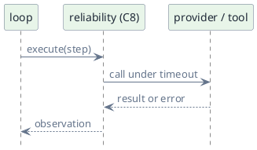
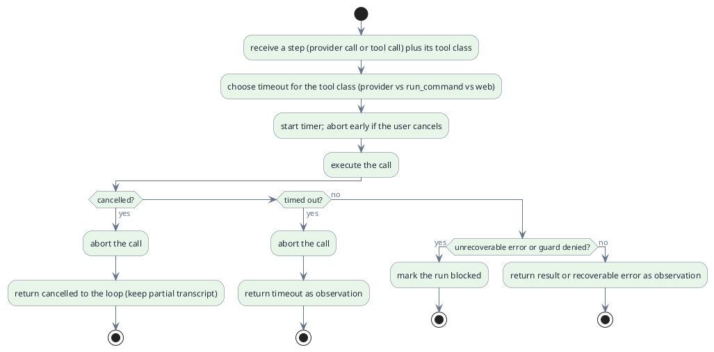

# C8 — Reliability

> Status: draft · Version 0.9 · **Current tier: Prop**

Reliability is what keeps a run bounded and recoverable: `C8` defines the
guardrails around every step and the rules for turning failures into
observations. The loop drives; reliability keeps it from running away or
dying silently.

## Overview

Every tier runs the loop under the same guardrails, and every provider and
tool call passes through them. The tiers differ in how much recovery and
observability is added: a progress-driven budget, per-tool-class timeouts,
in-loop retry with provider-timeout backoff, and cancellation at Prop;
structured logs, provider failover, concurrent runs, service supervision,
and a durable idempotent task queue at Pilot; tracing, cost accounting, and
self-heal at Orbit.

Reliability wraps calls; it does not decide what to do with the result. The
loop owns control flow (retry by re-iterating, or block), while reliability
owns the bounds on each call.

## Prop

Prop defines four guards: a progress-driven budget, per-tool-class
timeouts, in-loop retry, and user cancellation. The budget bounds, the
timeouts, and the provider retry policy are compiled-in constants — they
are built in and not configuration or policy (`safety`, C10, is where
guards become policy). A timeout or other recoverable error is returned to
the loop as an observation, which re-iterates and counts toward the stall
budget unless it makes progress — except a provider *timeout*, which is
retried in place first (see below); an unrecoverable error or a guard
denial marks the run blocked.

- **Progress-driven budget.** A run is bounded by *stalls*, not by raw step
  count: it continues while steps make progress — a plan item newly completed,
  or an observation not seen before in the run — and ends after a compiled-in
  number of consecutive non-progress steps. A repeat of the same call with the
  same result, a recoverable error, or a timeout makes no progress and counts
  toward the stall budget, so a loop that keeps producing the same output is
  cut off. One exception: a repeat that *recovers* content `context` (C4)
  cleared to a placeholder is progress — the model could not see the earlier
  result, so the re-fetch delivered new information, and the clearing
  placeholder's invitation to re-run must not be a trap. Recovery is
  credited once per call in a run; looping re-fetches after that are
  ordinary stalls. A much larger
  compiled-in step ceiling remains only as a runaway
  safety net, so long productive work is never cut off by step count. The
  bound is enforced by the loop (C1) and cannot be raised by the user at
  Prop.
- **Per-tool-class timeouts.** Every provider and tool call is bounded by a
  timeout chosen by class: a model timeout for provider calls, a longer build
  timeout for `run_command` (C3) so compilers and test suites can finish, and
  a shorter web timeout for the network tools (C3). On expiry the call is
  aborted and surfaced as a timeout. A streamed provider call uses an
  *inactivity* timeout — reset on each chunk — instead of a single total
  deadline, so an actively producing stream is not cut off.
- **Cancellation.** A user cancel (`interface`, C6) is noticed inside the
  in-flight call, not only between steps: the loop passes the cancel signal
  into the provider or tool, which aborts at once — the provider's HTTP
  request and response stream are closed, and a running `run_command` process
  is killed — and ends the run without marking it blocked; the partial
  transcript is kept in the session (C5). A call that is already consuming
  model output stops where it is rather than waiting for the stream to
  finish.
- **In-loop retry.** A recoverable error other than a provider timeout is
  returned as an observation, and the loop simply re-iterates, each iteration
  counting toward the stall budget unless it makes progress. A provider
  *timeout*, however, is a transport failure rather than model behavior, so it
  is retried in place before the loop sees it: a compiled-in number of retries
  with exponential backoff (the sleep is injectable, so the gate pins it to a
  no-op). Only an exhausted timeout — after its retries are spent — is
  returned as an observation and counts toward the stall budget. A retry that
  succeeds is invisible: the transcript is unchanged and the budget is
  untouched, so a brief provider outage does not end a long, productive run.
- **Deep abort.** Aborting a timed-out provider call cancels the HTTP
  request; aborting a timed-out `run_command` (C3) must terminate the whole
  child process tree so no processes leak.
- **Batch steps.** A step's tool calls each run under their class timeout; the
  independent read-only calls run in parallel, so the step's wall time is the
  longest call rather than their sum, and one call's timeout or denial does not
  discard its already-completed siblings' observations.
- **Background jobs.** A `job` (C3) runs under the same host shell as
  `run_command`; a job that exceeds its class budget is stopped and reported,
  and every job is reaped when the run is cancelled or the session closes, so
  no child process outlives the agent.
- **Blocking.** An unrecoverable error or a guard denial marks the run
  blocked and the loop aborts.
- **Best-effort finish.** If the run stalls or hits the step ceiling, the loop
  makes one final provider call under the model timeout, with tools withheld
  so the model must answer in text; it does not re-enter the loop and the
  answer is marked incomplete (C1). If that call fails or comes back empty,
  the answer falls back to a local summary of the plan and last observation.
- **No logging or failover.** Structured logs and provider failover down a
  chain are Pilot concerns; at Prop the only parallelism is the read-only
  calls within one step (*Batch steps*), and the only backoff is the
  provider-timeout retry above.

## Pilot

Pilot adds the Prop-declared reliabilities — structured logs, provider
retry with backoff, concurrent runs — plus **service supervision** and
a **durable, idempotent task queue** for the autonomy layer. Every
addition keeps the guards compiled-in and injects its environment
dependencies, so the gate stays offline and deterministic.

- **Structured logs.** One append-only JSONL stream to `log_file`
  (default `<primary root>/.sudoer/logs/agent.jsonl`), events shaped in
  [log.schema.json](agent_pilot/log.schema.json): `run_start`,
  `run_end`, `step`, `tool_call`, `provider_call`, `policy_decision`,
  `task_scheduled`, `task_fired`, `task_done`, `channel_in`,
  `channel_out`, `config_changed`, `service_start`, `service_stop`.
  Times come from the injected clock;
  secret values are scrubbed (`C10`) before any line is written.
- **Retry, then failover.** Pilot inherits Prop's in-place provider-timeout
  retry (a compiled-in count of 2, exponential backoff 0.5s ×4 capped at
  30s; the sleep primitive is an injected adapter) and extends it: once the
  retries on one provider are spent, the call fails over down the chain
  (`C2`), and only then surfaces with Prop's timeout/unrecoverable
  semantics. The loop's stall budget is untouched: hidden retries never
  consume it.
- **Concurrent runs.** Runs may proceed in parallel across sessions;
  within a session they serialize (a busy session rejects, never
  queues). Background runs (`C11`) are capped by a compiled-in
  concurrency limit; excess fires queue. The session index, memory
  store and embedding index, task list, policy log, and JSONL log are
  all written atomically or append-only, so concurrent access cannot
  tear a record.
- **Service supervision.** The resident service (`C6`, `C11`) reloads
  the task store and re-arms the next wake on start, resumes unfinished
  background runs, and shuts down cleanly on SIGTERM, reaping jobs
  (`C3`). A crash loses no task: the store is on disk and firing is
  idempotent.
- **Durable, idempotent firing.** A fired task is recorded as fired
  (per `(task id, due)`) *before* its run starts, so a crash, a
  redundant OS wake, or a duplicate timer tick cannot double-fire or
  double-send. An interrupted run resumes at the same fire. Delivery to
  a channel (`notify`, a registered channel) is attempted under the
  tool's timeout and recorded; a failed delivery is retried on the next
  tick, not lost.
- **Injected environment.** The clock (`C11`), the OS scheduler, the
  backoff sleep, the desktop notifier (`C3`), channel delivery (`C6`),
  and the memory embedder (`C9`) are all injected dependencies — the
  gate pins them to fakes, so wall-clock, OS state, real messages, and
  model embeddings never enter gate results.
