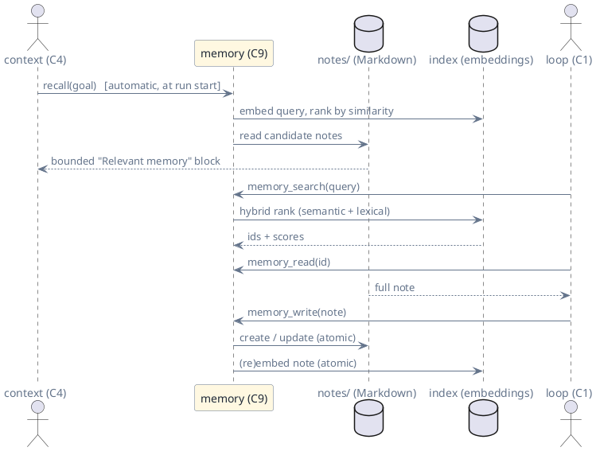

# C9 — Memory

> Status: draft · Version 0.2 · **Current tier: Prop**

Memory is what the agent still knows after every session closes: `C9` is
the durable, curated knowledge store the agent reads and writes across
sessions — and, at Pilot, **recalls semantically**. Sessions remember a
conversation; memory remembers facts, and finds them by meaning, not
only by exact words.

## Overview

A session (C5) persists a transcript — continuity of one conversation.
Memory persists *knowledge*: the durable facts, preferences, and
reference notes the agent judges worth keeping, stored as plain Markdown
the user can read and edit, alongside a derived embedding index that
makes them searchable by meaning. Every tier above Prop carries it:
durable Markdown notes with **semantic** recall at Pilot, a
cross-device/pluggable store at Orbit.



The *store* is deterministic — plain files, atomic writes, exact
ranking — so what memory contains and finds is reproducible. The
embedder is a model, but it is an **injected adapter** with a
deterministic fallback, so the gate pins both capture and retrieval.
What is *worth remembering* and which hit is *relevant* are model
judgments, made in the loop (C1), not here (arch.md, capability
boundary).

## Pilot

Memory is a directory of Markdown notes, one file per note, tooled by
three built-in tools, one interface command, and an automatic recall
hook. It lives under `memory_dir` (config, `C6`), defaulting to
`<primary root>/.sudoer/memory`.

### Note files

One note per file, named `<id>.md`. The file is a fixed-key front-matter
block followed by Markdown body:

```markdown
---
id: plant-watering
title: Plant watering schedule
tags: home, plants
created: 2026-10-05T10:00:00Z
updated: 2026-10-05T10:00:00Z
---
Water the ferns every three days; the succulents every two weeks.
```

- **Fixed keys.** Exactly `id`, `title`, `tags`, `created`, `updated`,
  one `key: value` line each; `tags` is a comma-separated list. The
  parser accepts only this shape; a file missing front-matter is
  reported, not guessed at.
- **Human-editable.** The store is plain Markdown the user may read and
  edit directly; the agent never holds the only copy in a binary format.
  An edit that breaks the front-matter shape surfaces as an error
  observation naming the file, not a silent skip.
- **Identifiers.** `id` is a slug (lowercase, `[a-z0-9-]`); when
  `memory_write` omits it, it is derived from the title. The id must
  match the filename.
- **Atomic writes.** A note is written through a temp file and renamed,
  like session files (C5), so a concurrent reader never sees a torn
  note.

### Embedding index

Recall by meaning needs vectors. The index is a single derived file,
`<memory_dir>/index.json`, frozen in
[memory.schema.json](agent_pilot/memory.schema.json):
`{model, dim, hash, vectors: {<id>: [<float>, …]}}`.

- **Derived, never authoritative.** The index is rebuilt from the note
  files; deleting it and rebuilding yields the same content modulo
  model, and the gate pins a deterministic embedder, so it is
  byte-stable. It is not a second source of truth.
- **Rebuildable and self-healing.** A note whose `updated` is newer
  than its entry (or a missing entry) is re-embedded on the next write
  or on `/memory rebuild`; a note deleted on disk drops from the index
  on the next scan.
- **Atomic.** Written temp-and-rename, like every shared store
  (`C5`, `C8`).

### Embedder

The embedder is a pluggable adapter selected by `memory.embedder`
(config, `C2`, `C6`):

| Kind | Meaning |
| --- | --- |
| `ollama` (local default) | Embeddings from a local ollama endpoint (`/api/embeddings`), the same backend family as the provider chain; keeps memory on-device. |
| `local` | A bundled on-device model, used when the build ships one. |
| `none` | No semantic path; lexical only. |

- **Deterministic fallback.** If the configured embedder is unavailable
  (offline, error, or absent), memory degrades to a deterministic
  lexical embedder (hashed bag-of-words) so retrieval never fails, and
  the degradation is reported, not silent. The gate pins this fallback
  as well as a fake semantic embedder, so both paths are covered.
- **Batched and bounded.** Embedding happens on write and on query,
  under a timeout, with a compiled-in batch cap.

### Tools

All three are built-in catalog tools (C3), text in and out, and frozen
in [memory.schema.json](agent_pilot/memory.schema.json) (arguments) and
[tools-pilot.schema.json](agent_pilot/tools-pilot.schema.json):

| Tool | Arguments | Result |
| --- | --- | --- |
| `memory_write` | `{id?, title, tags?, body}` | creates or updates the note; returns the id |
| `memory_search` | `{query}` | top N hits as `id — title (score, matched tag or snippet)` lines |
| `memory_read` | `{id}` | the note's full Markdown body |

- **Hybrid, deterministic ranking.** `memory_search` combines a lexical
  score (exact tag > title substring > body substring) with cosine
  similarity from the embedder, normalized and summed, then breaks ties
  by alphabetical id. N is a compiled-in cap (10), like `search` results
  (`C3`). The result is a *catalog* — the model picks what to
  `memory_read`; relevance is a loop judgment, never a store promise.
- **Model-invoked capture.** The loop decides when something is worth
  keeping — a stated preference, a durable fact, a project reference —
  and writes it through `memory_write`. A "remember that …" goal is
  directed to do so by the personal-task contract (`C4`). There is no
  automatic shadow capture of transcripts into memory at Pilot.
- **Update is replace.** `memory_write` with an existing id rewrites
  title, tags, and body, stamps `updated`, preserves `created`, and
  re-embeds. There is no merge; the model composes the new body.

### Recall

Recall has two paths, so the agent does not have to *choose* to
remember:

- **Automatic injection.** At the start of a run, `C4` asks memory for
  the top-K notes relevant to the goal (`recall(goal)`) and injects a
  bounded **"Relevant memory"** block into the prompt. The block is a
  goal-stable segment, so prompt-prefix caching (`C4`) still holds
  within the run. The model sees the notes without a tool call.
- **Prompted search.** The system prompt (`C4`) carries a memory
  section — when to write (durable, reusable facts and preferences),
  when to search (the goal references past preferences, people,
  projects, or schedules), and that memory is the agent's own knowledge
  base — and the tools above are always available for a deeper look.
  No other note text enters a prompt except through these observations.

A recall that finds nothing says so; the agent never pretends to
remember.

### Boundaries

- **Session ≠ memory.** Session search (C5) finds *conversations*;
  memory search finds *notes*. Session transcripts are never folded into
  memory implicitly.
- **Local and plain.** Notes are local files; the embedding index is
  local and derived. Cross-device sync and pluggable remote stores are
  Orbit.
- **No memory over HTTP** in the Pilot API surface (`C6`); memory is
  reached through the CLI/web/channel session's tools and the recall
  hook.
